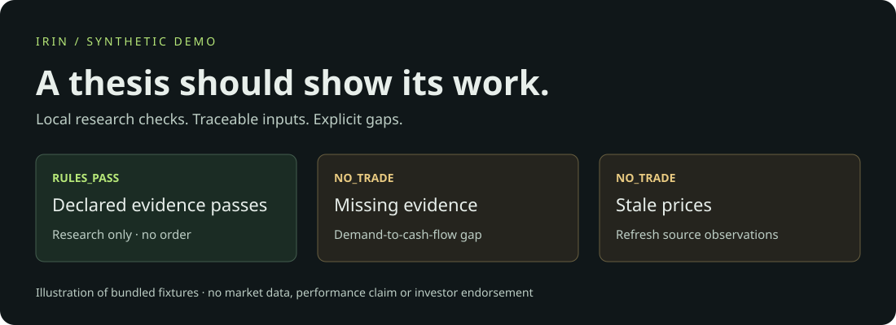
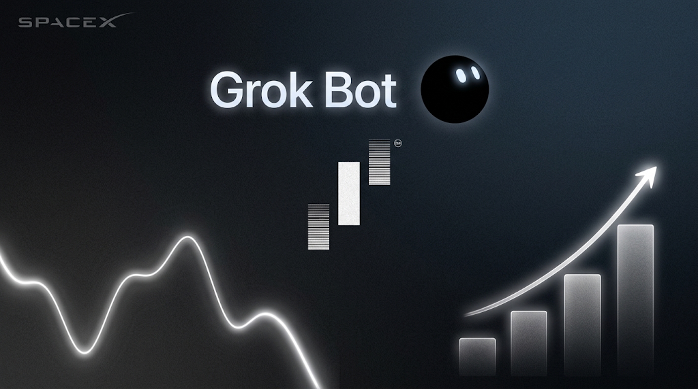

# Bottleneck Atlas

**Show the evidence. Expose the gaps.**

[](https://www.python.org/downloads/) [](LICENSE)

Public edition **1.2.0**. A Grok Bot research kit for **AI infrastructure, minerals, and power**. Turn a local, source-linked equity snapshot into deterministic research checks, explicit blockers, and an inspectable report.





*Illustrative artwork; this community project is not affiliated with xAI or SpaceX.*

## Try it in one command

From this repository's root, with **Python 3.11 or newer** installed:

```bash
python3 -m atlas demo
```

No packages, account, database, API key or network connection are needed for the demo. It writes `demo-output/report.html` and `demo-output/results.json`. Open the HTML file in a browser.

```text
RULES_PASS | SYNTHETIC | DEMO-GRID | execution disabled
NO_TRADE   | SYNTHETIC | DEMO-GRID | execution disabled
NO_TRADE   | SYNTHETIC | DEMO-GRID | execution disabled
```

The scenarios show an all-pass synthetic example, missing evidence, and stale prices. They are fixed historical fixtures, not current market observations, recommendations, or investment returns.

## Why this exists

An AI-written investment thesis can sound complete while its evidence is stale, its cash-flow link is missing, or its position size breaks a limit. Bottleneck Atlas makes these gaps inspectable. The useful output is often **NO_TRADE**, with a reason for each blocked check.

- **Evidence chain:** AI demand → customer contracts → revenue/backlog → margin and cash flow.
- **Deterministic checks:** valuation, listing/focus, trend, liquidity, balance-sheet vetoes, sizing and portfolio room.
- **Provenance boundary:** dates, availability, publisher/upstream independence and complete chain links are checked before grading.
- **Reproducibility:** normalized input and rule-file SHA-256 hashes accompany each result.
- **Local reports:** escaped HTML and JSON, without remote assets, tracking or email delivery.
- **Grok Bot workflow:** a profile, skill, bootstrap prompt and optional research routine, with evidence and output contracts.

## Run a persistent paper simulation

```bash
python3 -m atlas paper-demo
```

This second offline demo persists and reloads a synthetic portfolio through a queued signal, a later-session fill and a gap-stop exit. It writes a simulated ledger plus portfolio HTML/text in `demo-output/paper/`. No account or API key is required.

For your own ledger, start with [cloud and paper setup](docs/CLOUD.md) and [accounting](docs/ACCOUNTING.md). It supports local SQLite or a new installation-owned Supabase project, explicit virtual capital and enablement, atomic/idempotent commits, sequential daily runs, simulated costs and stops, risk/concentration/frequency limits, portfolio snapshots, and reports. It has no original project, client, recipient or account defaults.

Initialize your own ledger once before running it; omit `--synthetic` only when you have prepared real observations. Bookkeeping is supplied explicitly, and CAD settlement requires a funded CAD sleeve. The following run expects your own complete files:

```bash
python3 -m atlas paper init --capital 25000 --synthetic
python3 -m atlas paper enable
python3 -m atlas paper run local-data/snapshot.json --as-of 2026-10-30T22:00:00Z --bookkeeping local-data/bookkeeping.json
python3 -m atlas paper report --week 2026-10-26 --as-of 2026-11-02T22:00:00Z --currency CAD
```

Read [ACCOUNTING.md](docs/ACCOUNTING.md) for FX, action and split-history contracts, and [BENCHMARKS.md](docs/BENCHMARKS.md) for comparison schemas and unavailable-data rules.

## Use it with Grok Bot

Start with [SETUP.md](SETUP.md), then [agent/PROFILE.md](agent/PROFILE.md) and [the research skill](skills/bottleneck-atlas/SKILL.md). Paste the bootstrap prompt from SETUP into your Bot after placing this folder on its computer.

This is a **community workflow pack designed for Grok Bot**, not an official xAI product, hosted service, or Grok API trading bot. The Python demo is tested locally. Importing this skill and running the complete workflow inside Grok Bot still need an end-to-end acceptance test. Grok Bot access, connected sources, and optional data services can have separate costs. [Official skills and routines documentation](https://docs.x.ai/grok-bot/skills-routines-and-automations).

## Evaluate your own snapshot

Use [examples/synthetic.json](examples/synthetic.json) to learn the shape; read [the input contract](docs/INPUTS.md) before supplying real observations.

```bash
python3 -m atlas evaluate examples/synthetic.json --as-of 2026-10-23T22:00:00Z
```

Without `--as-of`, evaluation uses the current UTC time. Historical evaluation only uses the provided snapshot; it does not reconstruct historical data or prove there is no look-ahead bias. Real inputs must use `synthetic: false` and eligible `operator_attested` source records. Synthetic URLs and hashes cannot be relabelled as real by changing that flag alone.

**RULES_PASS means the supplied inputs satisfy these heuristics.** Sources, upstream independence, fundamentals and portfolio state are supplied by the operator. The program validates their structure and timestamps; it does not fetch, authenticate or independently verify them. Every result remains `RESEARCH_ONLY` with `execution_enabled: false`.

## What's included

| Path | Purpose |
|---|---|
| `atlas/` | Research validation, paper ledger, local/cloud stores, CLI, price refresh and reports |
| `engine/` | Pure equity indicators, research rules, hypothetical sizing and exit helpers |
| `examples/` | Entirely synthetic input |
| `agent/`, `skills/`, `ops/routines/` | Grok Bot workflow instructions |
| `tests/` | Research, ledger, report, CLI, market-parser and real PostgreSQL integration checks |
| `database/` | Clean service-worker cloud migration with no inherited state |
| `docs/` | Architecture, input contract, limits and release checklist |
| `tools/release_check.py` | Local privacy/secret-pattern and release-file checks |

The cloud migration is a clean, generic store for this installation. No inherited approvals, private research, historical client reports, recipients, credentials or private brand assets are included. Optional daily/weekly routines start disabled; report delivery requires explicit configuration and a period reservation. This is a fresh public installation, not a migration of private deployment history.

## Know the limits

No validated alpha, backtest, live performance, benchmark outperformance or audited win rate is claimed. The 13 named lenses in the retained engine are project-authored heuristics inspired by published investing concepts. They do not replicate, consult, speak for, or imply endorsement by any investor. Reported targets are hypothetical rule inputs, not forecasts.

The standalone research evaluator stays `RESEARCH_ONLY`. The explicit `paper` commands persist simulated money and hypothetical positions; broker execution remains absent. The entry model requalifies at the next session close and simulates that same close, an idealization that can bias results. USD-base accounting now includes native USD/CAD cash settlement, explicit fee-bearing conversions, dividend receivables, reviewed corporate actions and operator-configured benchmarks. CAD reporting is a view of the USD ledger. Source, distribution-completeness, withholding and cost-basis inputs remain operator attestations; tax filing and broker reconciliation are absent. See [LIMITATIONS.md](docs/LIMITATIONS.md), [market data](docs/MARKET_DATA.md) and the [feature map](docs/FEATURE_PARITY.md).

## Develop

```bash
python3 -m unittest discover -s tests -v
python3 tools/release_check.py
```

CI runs Python checks on 3.11 and 3.14 and a disposable PostgreSQL integration job. A passing local run is not a claim that hosted CI has run. Contributions that make rejected and uncertain inputs easier to understand are welcome; see [CONTRIBUTING.md](CONTRIBUTING.md).

[MIT licence](LICENSE). This project does not constitute financial advice. Research and simulated outputs can be wrong, and passing tests do not establish investment suitability.


Try the extended offline accounting flow:

```bash
python3 -m atlas accounting-demo --output demo-output/accounting
```

It persists a dated conversion, entry, dividend entitlement/payment, split and cash merger; generates a CAD report; and verifies the audit chain. Figures and index levels are synthetic. A partial-week comparison remains unavailable.

Advanced operating guides: [research observations](docs/RESEARCH_DATA.md), [batch universe checks](docs/BATCH.md), [readiness and review deadlines](docs/GOVERNANCE.md), [cloud and audit setup](docs/CLOUD.md). These are user-configured mechanisms; the package contains no inherited account, watchlist, recipient or deployment state.
